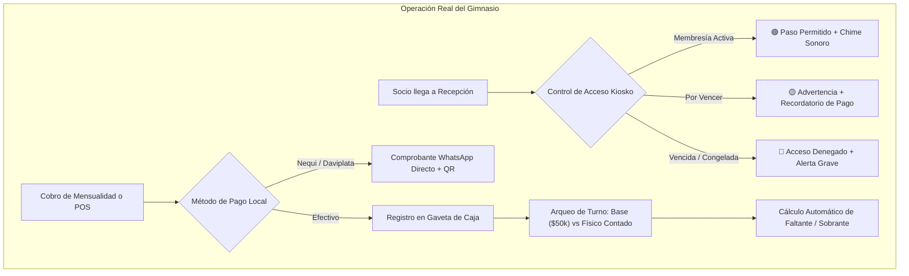
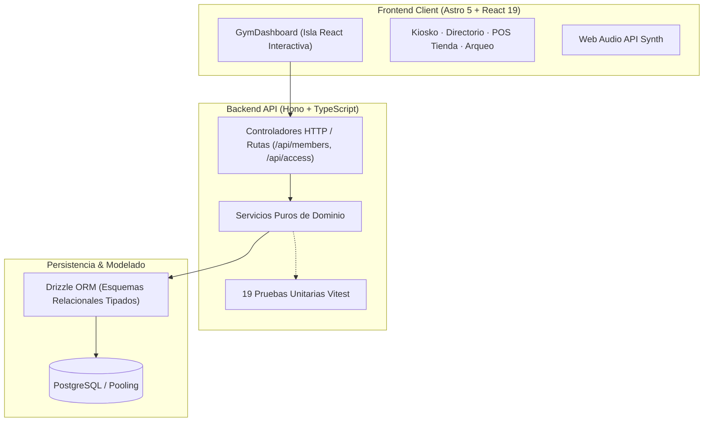

# 🏋️ Proyecto Gym — Sistema Integral de Gestión y Control de Gimnasios

<div align="center">

-10b981?style=for-the-badge&logo=vitest&logoColor=white)


-FFD700?style=for-the-badge)

<br/>

[](https://proyecto-6bxqv16ow-gabmon24.vercel.app)

<p align="center">
  <strong>Sistema operativo de alto rendimiento diseñado para la economía y operación real de gimnasios en Colombia.</strong><br>
  Tarifas estándar en COP ($60.000/mes) · Pagos por Nequi, Daviplata y Efectivo · Carnet Digital QR · Kiosko con Audio-Feedback · Arqueo de Caja diario · Motor de Festivos (Ley Emiliani).
</p>

</div>

---

## 💡 ¿Por qué este proyecto demuestra entendimiento del Negocio Real?

La mayoría de proyectos junior son clones superficiales sin reglas de negocio. **Proyecto Gym** fue diseñado resolviendo los dolores operativos reales que sufren los dueños y administradores de gimnasios en Colombia:



1. **Economía Real en Pesos Colombianos (COP):** Tarifas de mercado estándar en Colombia ($60.000 COP mensualidad, $160.000 COP trimestral, $10.000 COP pase diario).
2. **Pagos Locales & Arqueo de Caja:** En Colombia, el 80% de los pagos en gimnasios no pasan por datáfono tradicional, sino por transferencias móviles (**Nequi / Daviplata**) o efectivo físico. El sistema consolida cada método y realiza el arqueo de turno contra la base inicial, detectando descuadres al centavo.
3. **Punto de Venta de Barra (Nevera & Suplementos):** Venta rápida en 1-clic de hidratación (Aguas, Gatorade, Speed Max) y suplementación deportiva (scoops de proteína/creatina), sumándose de inmediato al saldo de caja del turno.
4. **Carnet Digital de Socio VIP con QR:** Credencial virtual estilo *Apple Wallet* con foto, vigencia y código QR dinámico que los socios pueden llevar en su teléfono o recibir por WhatsApp para agilizar el ingreso.
5. **Motor de Festivos Nacionales (Ley Emiliani):** Colombia es uno de los países con más días feriados del mundo (18 días). El backend implementa el algoritmo astronómico de Meeus para calcular Semana Santa y trasladar festivos a los lunes según la Ley 51 de 1983, permitiendo compensaciones justas a los socios.
6. **Audio-Feedback Nativo (Web Audio API):** El kiosko reproduce tonos físicos de torniquete sintetizados en el navegador (agudo de confirmación o alerta grave de vencimiento) sin librerías externas ni archivos de audio pesados.

---

## 🏛️ Arquitectura de Software Limpia (Clean Architecture)

El proyecto mantiene una estricta separación de responsabilidades, dividiendo el dominio del negocio, la persistencia y la interfaz de usuario:



---

## 🧪 Pruebas Unitarias Automatizadas (Vitest)

El corazón de la lógica de negocio cuenta con una suite completa de pruebas unitarias que validan estados de membresía, cálculos financieros y auditoría de notificaciones:

```bash
$ npm test

 ✓ src/services/__tests__/cash-register.service.test.ts (4 tests) 16ms
 ✓ src/services/__tests__/email.service.test.ts (3 tests) 17ms
 ✓ src/services/__tests__/membership.service.test.ts (12 tests) 19ms

 Test Files  3 passed (3)
      Tests  19 passed (19)
   Duration  648ms (100% Passing)
```

---

## 🛠️ Stack Tecnológico

| Capa | Tecnologías | Propósito |
| :--- | :--- | :--- |
| **Frontend UI** | Astro 5, React 19, Tailwind CSS v4 | Interfaz ultra reactiva con renderizado de islas y tokens de color OKLCH |
| **Backend API** | Hono sobre Node.js, TypeScript estricto | Servidor ligero, veloz y completamente tipado de extremo a extremo |
| **Persistencia** | PostgreSQL con Drizzle ORM | Consultas parametrizadas seguras contra inyección SQL y migraciones controladas |
| **Validación** | Zod | Validación fail-fast de variables de entorno y DTOs de entrada |
| **Testing** | Vitest | Pruebas unitarias de ejecución instantánea (<700ms) |
| **Hardware / Web** | Web Audio API, FileReader API | Sonidos de torniquete nativos y procesamiento de avatares en cliente |

---

## 📁 Estructura del Repositorio

```
proyecto-gym/
├── client/                               # Frontend Web (Astro 5 + React 19)
│   ├── src/
│   │   ├── components/
│   │   │   └── GymDashboard.tsx          # Consola ejecutiva unificada del gimnasio
│   │   ├── layouts/
│   │   │   └── Layout.astro              # Layout base con cabecera y metadatos SEO
│   │   ├── pages/
│   │   │   └── index.astro               # Isla interactiva principal
│   │   └── styles/
│   │       └── global.css                # Tailwind v4 con tokens de color OKLCH
│   ├── astro.config.mjs
│   └── package.json
│
├── src/                                  # Backend API & Servicios de Dominio
│   ├── config/
│   │   └── env.ts                        # Variables de entorno validadas con Zod
│   ├── db/
│   │   ├── schema.ts                     # Modelos relacionales Drizzle ORM
│   │   ├── seed.ts                       # Semilla de datos iniciales
│   │   └── index.ts                      # Pool de conexión a PostgreSQL
│   ├── routes/                           # Controladores de rutas HTTP (Hono)
│   │   ├── member.routes.ts
│   │   ├── subscription.routes.ts
│   │   └── access.routes.ts
│   ├── services/                         # Lógica pura de negocio
│   │   ├── membership.service.ts
│   │   ├── cash-register.service.ts
│   │   ├── colombian-holidays.service.ts
│   │   ├── email.service.ts
│   │   └── __tests__/                    # Tests unitarios con Vitest (100% passing)
│   └── index.ts                          # Servidor principal Hono
│
├── drizzle.config.ts
├── package.json
├── tsconfig.json
├── .env.example
└── README.md
```

---

## 🚀 Puesta en Marcha Local

### Prerrequisitos
- Node.js >= 20.x
- npm >= 10.x

### 1. Clonar el repositorio
```bash
git clone https://github.com/Gabmon24/proyecto-gym.git
cd proyecto-gym
```

### 2. Iniciar el Frontend (Panel del Gimnasio)
```bash
cd client
npm install
npm run dev
```
> Abrir en el navegador: `http://localhost:5173`

### 3. Ejecutar Pruebas Unitarias del Backend
```bash
# Desde la raíz de proyecto-gym:
npm install
npm test
```

---

## 👨‍💻 Autor

Desarrollado con orgullo por **Gabriel Montiel** ([@Gabmon24](https://github.com/Gabmon24))
- 🎓 **Licenciado en Informática**
- 🚀 **Tecnólogo en Análisis y Desarrollo de Software (ADSO - SENA)**
- 📍 Colombia 🇨🇴 · *Open to Remote Software Engineering Roles*
